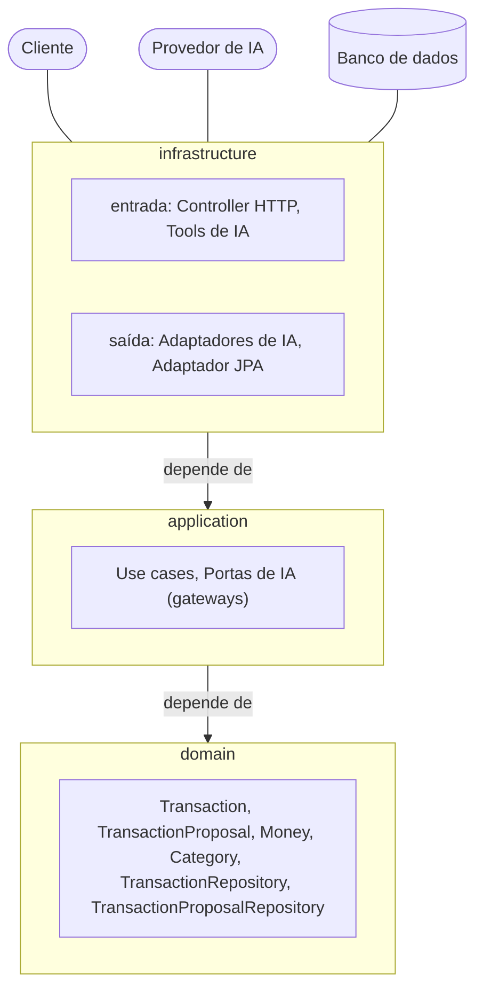
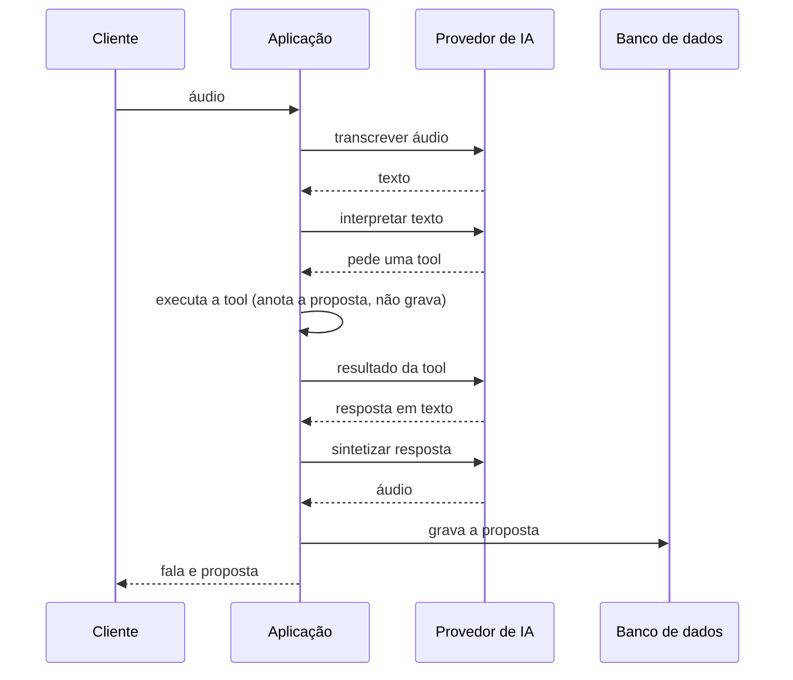
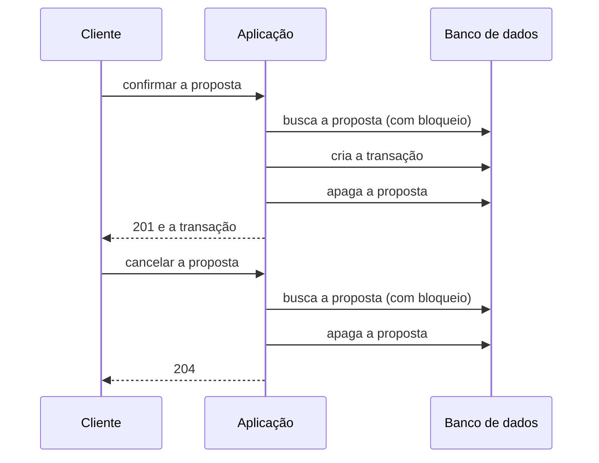

# Arquitetura

## Camadas

A aplicação é organizada em três camadas, e as dependências apontam sempre para dentro: `infrastructure` depende de
`application`, que depende de `domain`. As integrações externas (cliente HTTP, provedor de IA, banco de dados) entram
e saem por adaptadores em `infrastructure`; `application` as enxerga só por portas (interfaces).

## Fluxo de voz

O cliente envia o áudio de um comando. A aplicação o transcreve e pede ao provedor de IA que interprete o texto. Quando
o modelo pede uma tool, ela é executada: uma consulta devolve o resultado ao modelo; um registro **não grava**, só anota
a proposta do modelo, e o modelo recebe apenas "aguardando confirmação do usuário". A resposta em texto é sintetizada
em voz e, só depois de a voz estar pronta, a proposta é gravada. O cliente recebe a fala e a proposta (`id`,
descrição, valor e categoria). Uma consulta, ou um conteúdo fora do escopo, recebe só a fala.

A proposta é gravada por último de propósito: nada é registrado antes de a resposta que o anuncia estar pronta, e uma
falha na síntese de voz não deixa uma proposta órfã. A chamada à IA nunca fica dentro de uma transação de banco.

## Decisão sobre a proposta

Confirmar ou cancelar é uma chamada explícita à API, sem IA: a decisão é determinística e não repete os erros de
transcrição e interpretação que a confirmação existe para barrar. As duas operações rodam em uma transação de banco
que começa buscando a proposta com bloqueio (`SELECT ... FOR UPDATE`) e termina apagando-a. Uma segunda decisão
simultânea espera o bloqueio, não encontra a proposta e responde 404, então nenhuma transação é criada em dobro. Uma
proposta inexistente, malformada, de outro usuário, já confirmada ou já cancelada responde o mesmo 404.

