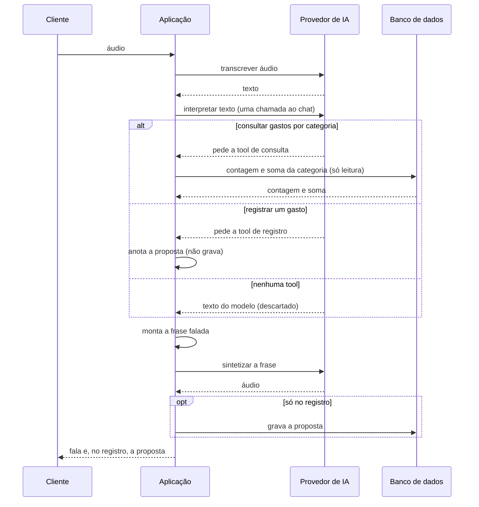
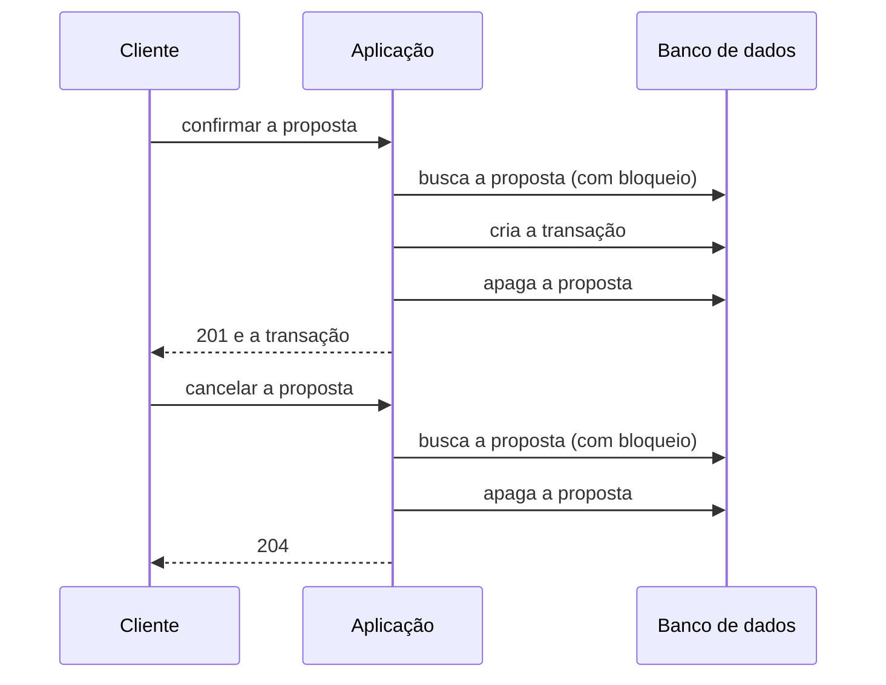

# Arquitetura

## Camadas

A aplicação é organizada em três camadas, e as dependências apontam sempre para dentro: `infrastructure` depende de
`application`, que depende de `domain`. As integrações externas (cliente HTTP, provedor de IA, banco de dados) entram
e saem por adaptadores em `infrastructure`; `application` as enxerga só por portas (interfaces).

## Fluxo de voz

O cliente envia o áudio de um comando. A aplicação o transcreve e pede ao provedor de IA que interprete o texto, que
chega ao modelo entre as marcas `<transcricao>` e `</transcricao>`, sem `<` nem `>` vindos da fala. O modelo só extrai a
intenção: ele escolhe uma tool (registrar um gasto ou consultar os gastos de uma categoria) e os argumentos, e nunca
escreve a resposta. A tool anota a interpretação e `returnDirect` encerra a chamada, então há uma única chamada ao chat
por comando e o resultado da tool nunca volta ao modelo. Um registro **não grava**, só anota a proposta; a consulta de
gastos por categoria calcula a contagem e a soma no banco e as anota. Quando o modelo não chama nenhuma tool (por
exemplo, um comando fora do escopo ou uma injeção que não resulta em tool), a interpretação é "não entendido" e o texto
que ele devolveu é descartado; uma segunda chamada de tool no mesmo comando é recusada (422).

A aplicação monta a frase falada a partir da interpretação (`SpokenAnswers`), sempre a mesma para a mesma entrada, e a
sintetiza em voz. Só depois de a voz estar pronta a proposta é gravada. O cliente recebe a fala e, no registro, a
proposta (`id`, descrição, valor, categoria e `expiresAt`). A consulta de gastos, ou um comando não entendido, recebe só
a fala.

A proposta é gravada por último de propósito: nada é registrado antes de a resposta que o anuncia estar pronta, e uma
falha na síntese de voz não deixa uma proposta órfã. A chamada à IA nunca fica dentro de uma transação de banco.

## Decisão sobre a proposta

Confirmar ou cancelar é uma chamada explícita à API, sem IA: a decisão é determinística e não repete os erros de
transcrição e interpretação que a confirmação existe para barrar. As duas operações rodam em uma transação de banco
que começa buscando a proposta com bloqueio (`SELECT ... FOR UPDATE`) e termina apagando-a. Uma segunda decisão
simultânea espera o bloqueio, não encontra a proposta e responde 404, então nenhuma transação é criada em dobro. Uma
proposta inexistente, malformada, de outro usuário, já confirmada, já cancelada ou vencida responde o mesmo 404.

A proposta vale por 5 minutos (configurável): `expiresAt` é gravado na criação, e a checagem (`isPendingAt`) acontece
depois da busca bloqueante, no instante exato, sem depender da faxina. Uma proposta vencida não é confirmada nem
cancelada, e a linha fica para a faxina.

## Faxina das propostas vencidas

Uma rotina agendada (`TransactionProposalExpirationJob`) apaga as propostas vencidas. Ela usa `fixedDelay`: o intervalo
(1 minuto por padrão) conta a partir do fim da execução anterior, então uma execução lenta nunca se sobrepõe à seguinte
na mesma instância. Cada execução lê o relógio uma vez e apaga em lotes (1000 por padrão), cada lote em sua própria
transação, com o mesmo instante, até um lote vir incompleto. A consulta do lote tranca as linhas com `SKIP LOCKED`: uma
proposta que uma confirmação ou um cancelamento está usando é pulada e fica para a próxima execução. A faxina é só
limpeza; a expiração vale sem ela.
