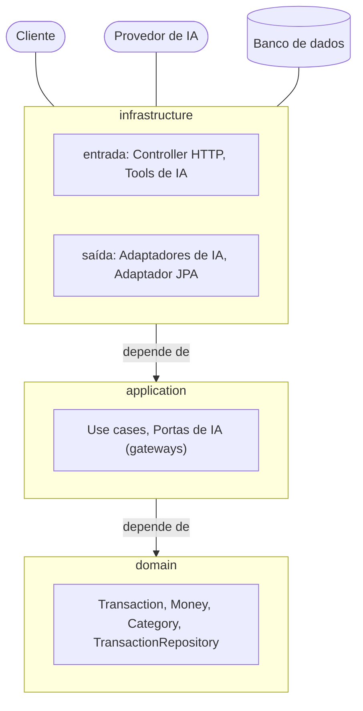
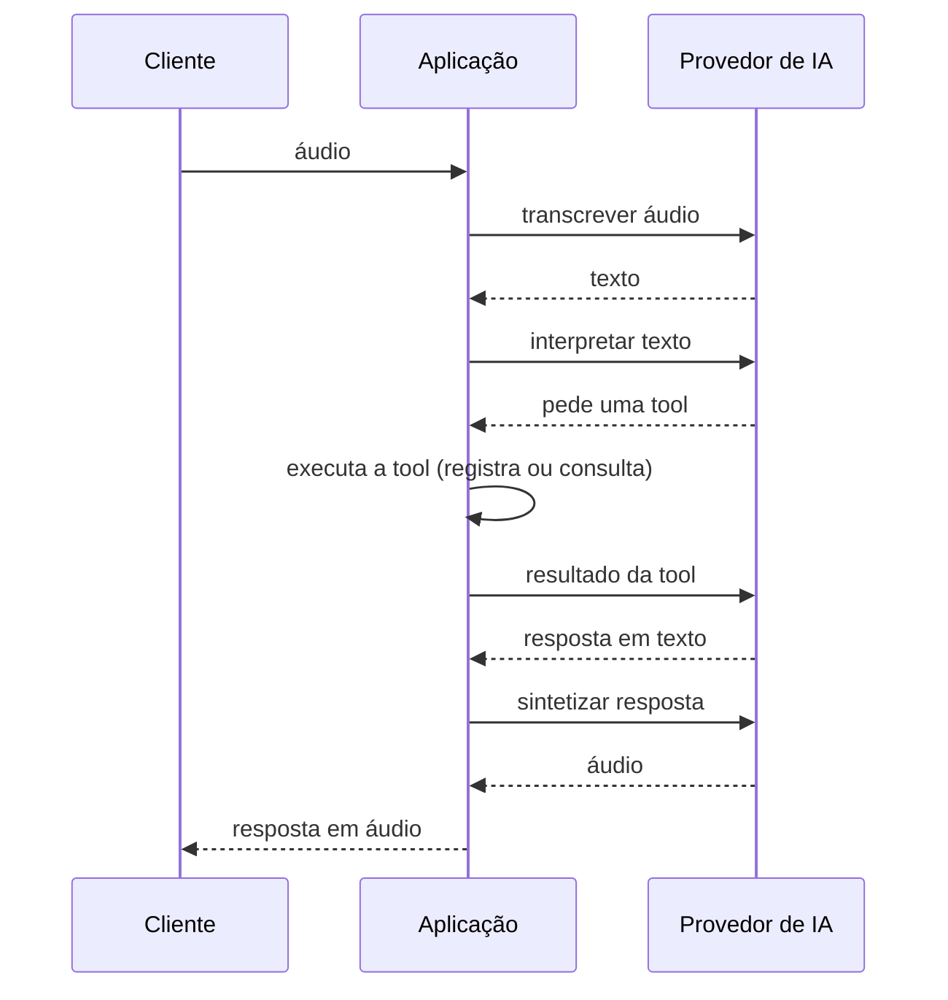

# Arquitetura

## Camadas

A aplicação é organizada em três camadas, e as dependências apontam sempre para dentro: `infrastructure` depende de
`application`, que depende de `domain`. As integrações externas (cliente HTTP, provedor de IA, banco de dados) entram
e saem por adaptadores em `infrastructure`; `application` as enxerga só por portas (interfaces).

## Fluxo de voz

O cliente envia o áudio de um comando. A aplicação o transcreve, pede ao provedor de IA que interprete o texto e,
quando o modelo pede uma tool, executa-a (registra ou consulta uma transação) e devolve o resultado ao modelo. A
resposta em texto é sintetizada em voz e volta ao cliente como áudio.

