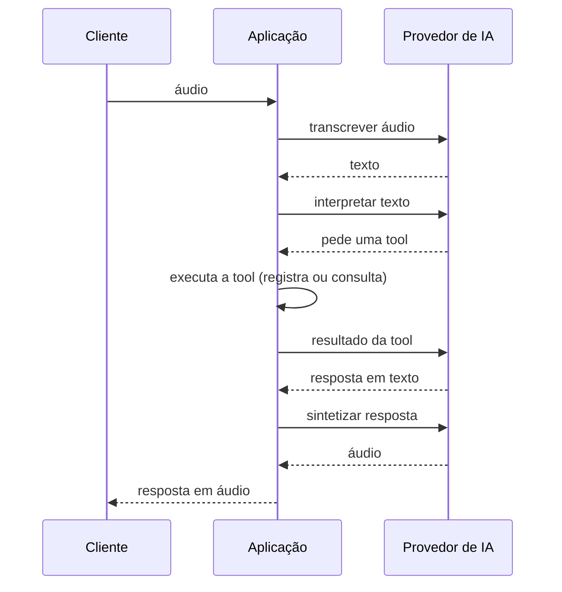
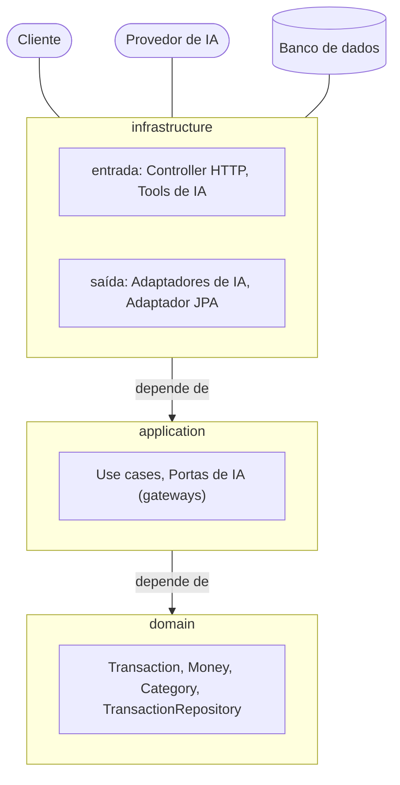

# T09 — Orquestração de IA na camada de aplicação

Mover o fluxo de voz (transcrição → interpretação → voz) do `TransactionController` para um use case em
`application`, com uma porta por etapa e exceções neutras do provedor de IA, sem alterar o comportamento externo
(FN-09). Criar os diagramas de arquitetura e de sequência do fluxo de voz (DOC-04).

## Escopo

**Dentro:**
- `application/` (raiz, sem subpacote `gateway/`):
  - `ProcessVoiceCommandUseCase.execute(UserId userId, ProcessVoiceCommandInput input)` → `VoiceCommandOutput`;
    sem `@Transactional` (só chamadas externas); orquestra as três portas em sequência
  - portas: `SpeechToTextGateway.transcribe(Audio audio)` → `String`;
    `AssistantGateway.interpret(UserId userId, String command)` → `String` (texto da resposta);
    `TextToSpeechGateway.synthesize(String text)` → `byte[]`
  - exceções neutras (unchecked): `AiProviderUnavailableException(Integer providerStatus, Throwable cause)`
    (transitória; `providerStatus` `null` em falha de rede) e `AiProviderFailedException(Throwable cause)` (definitiva)
- `application/input/`: `Audio(byte[] content, String filename, String contentType)` e
  `ProcessVoiceCommandInput(byte[] audio, String filename, String contentType)` com `toAudio()` (padrão do
  `PersistTransactionInput.toMoney()`); `application/output/`: `VoiceCommandOutput(byte[] speech)`
- logs: `Voice command received` (`audioSizeBytes`, `audioContentType`) fica no controller; `Audio transcribed`
  (`transcriptionLength`), `Assistant answered` (`answerLength`) e `Speech synthesized` (`speechSizeBytes`) passam
  ao use case — mensagens e campos iguais aos de hoje
- `infrastructure/ai/`:
  - `SpringAiSpeechToTextGateway` (`TranscriptionModel`; os bytes num `ByteArrayResource` com `getFilename()`
    devolvendo o nome original — a OpenAI deduz o formato pela extensão)
  - `SpringAiAssistantGateway` (recebe o `ChatClient` pronto; `prompt().user(command).toolContext(Map.of(
    TransactionTools.USER_ID, userId)).call().content()`)
  - `SpringAiTextToSpeechGateway` (`TextToSpeechModel`)
  - `AssistantConfiguration` (`@Configuration`): `@Bean ChatClient` a partir do `ChatClient.Builder`, com
    `defaultSystem` lido de `classpath:prompts/system-message.st` em **UTF-8** e `defaultTools(TransactionTools)`
  - `OpenAiExceptionTranslationAspect` (`@Aspect`, `@Around` nas portas `*Gateway`): o único ponto com a regra
    transitória x definitiva (IO, 429, ≥ 500 → transitória); os adaptadores não tratam exceção; captura só a falha
    do provedor — as exceções de argumento de tool (`ConstraintViolationException`, `DatabindException`) passam
    intactas e continuam no 422
- `TransactionController`: recebe o upload, loga `Voice command received`, monta o `ProcessVoiceCommandInput`
  (`getBytes()`, `getOriginalFilename()`, `getContentType()`), chama o use case e devolve `audio/mpeg` com
  `Content-Disposition: attachment; filename="audio.mp3"` como hoje; sem import de Spring AI
- `ApiExceptionHandler`: `@ExceptionHandler(AiProviderUnavailableException.class)` → 503 `assistant-unavailable`
  com `Retry-After` e `WARN` `AI provider unavailable` (`status`, `providerStatus` quando houver);
  `AiProviderFailedException` cai no 500 genérico (`ERROR` com stack trace, causa encadeada); sem `com.openai.*`
- testes:
  - `ProcessVoiceCommandUseCaseTest` (unitário, `@Mock` nas três portas)
  - `support/ai/AiStage` (`TRANSCRIPTION`, `ASSISTANT`, `SPEECH`) e `AiStub.givenFailure(AiStage, AiFailure)` no
    lugar de `givenTranscriptionFailure`, implementado no `OpenAiWireMockStub` (`/v1/audio/transcriptions`,
    `/v1/chat/completions`, `/v1/audio/speech`)
  - `VoiceCommandIT`: 503 (falhas transitórias) e 500 (`REQUEST_REJECTED`) parametrizados por etapa; testes de log
    (`WARN`/`ERROR`) continuam só na transcrição
- documentação: `docs/arquitetura.md` (novo, dois diagramas Mermaid), linha no README, `CLAUDE.md`, regras em
  `.claude/rules/` e notas em `docs/tarefas.md`

**Fora:**
- mudança no contrato HTTP: `docs/openapi.yaml` e `docs/exemplos/transacoes.http` não mudam
- `ToolResponse` / mudar o que a tool devolve ao modelo (vai para T12 e T14)
- timeout e retry (T10), circuit breaker e bulkhead (T15), degradação (T16), validação do áudio (T11)
- teste unitário do `OpenAiExceptionTranslator` (o `*IT` percorre todos os ramos com respostas HTTP simuladas)
- ADR novo; o ADR 0003 (aceito) não é alterado
- deploy

## Decisões

- Uma porta por etapa (STT, assistente, TTS), não uma porta única — a orquestração fica em `application` e cada
  dependência pode ter timeout, retry, circuit breaker e degradação próprios (T10, T15, T16) (decisão do usuário)
- Sufixo `Gateway` para as portas de serviço externo — par do `Repository` (persistência), vocabulário que
  `architecture.md` já usa ("portas de gateway") (decisão do usuário)
- Nomes: `SpeechToTextGateway.transcribe`, `AssistantGateway.interpret`, `TextToSpeechGateway.synthesize`;
  adaptadores `SpringAi<Porta>` (padrão `Jpa<Porta>`) — o tipo nomeia o serviço pelo termo de mercado, o método a
  ação (decisão do usuário)
- Portas na raiz de `application/`, sem diretório `gateway/`, como `TransactionRepository` na raiz de `domain/`
  (decisão do usuário)
- Áudio como `byte[]` em records neutros (`Audio`, `ProcessVoiceCommandInput`) — sem Spring Web em `application`,
  releitura possível (retry da T10, hash da T17); o upload já fica inteiro em memória; `Audio` em `input/` deixa a
  porta independente do DTO do use case (decisão do usuário)
- `Voice command received` no controller (evento do adaptador HTTP); eventos das etapas no use case, que orquestra,
  como os outros use cases logam os próprios eventos (decisão do usuário)
- Duas exceções neutras (transitória x definitiva) e um tradutor único em `infrastructure/ai/`; não uma exceção com
  flag nem a definitiva propagada como exceção do SDK — cada uma tem destino próprio no advice, e T10/T16 decidem
  pelo tipo no `catch` sem ver tipos da OpenAI (decisão do usuário)
- `ChatClient` como `@Bean` no `AssistantConfiguration`, não montado no construtor do adaptador — separa o wiring
  do assistente (prompt, tools) do comportamento do adaptador; um segundo assistente seria outro `@Bean` com
  `@Qualifier` (decisão do usuário)
- Tradução por aspecto (`OpenAiExceptionTranslationAspect`, `@Around` em `execution(* ...application.*Gateway+.*(..))`),
  não por tradutor injetado nos adaptadores — mesma ideia da tradução de exceções de persistência do Spring: os
  adaptadores `SpringAi*Gateway` ficam sem código de erro e independentes de provedor, e o aspecto é a única classe
  que cita a OpenAI (trocar de provedor é trocar o aspecto). Declara `spring-boot-starter-aspectj` no
  `build.gradle`, em vez de depender do `aspectjweaver` que chega via `spring-boot-starter-data-jpa`. Mudança em relação ao plano original, aprovada na execução da fase 2 (decisão do usuário)
- Prompt lido em UTF-8 (`StandardCharsets.UTF_8`), como manda `ai-integration.md`; no Java 18+ o padrão já é UTF-8,
  então o comportamento não muda
- Testes: `givenFailure(AiStage, AiFailure)` genérico e `VoiceCommandIT` parametrizado por etapa — protege a
  tradução em cada adaptador; sem unitário do tradutor (decisão do usuário)
- `ToolResponse` fora da T09; a nota da T06 vai para a T12 (com menção na T14) (decisão do usuário)
- Diagramas em Mermaid num único `docs/arquitetura.md`, só o essencial: sequência com três participantes
  (Cliente, Aplicação, Provedor de IA) e arquitetura com camadas, adaptadores de entrada/saída e sistemas externos;
  sem nome de fornecedor ("Provedor de IA", "Banco de dados"), sem assinaturas de método, segurança ou erros; a T12
  acrescenta ali o diagrama de estados (decisão do usuário)
- Sem ADR — portas por etapa e exceções neutras seguem o padrão de portas e adaptadores já descrito nas regras
  (decisão do usuário)
- Três fases: rede de proteção e orquestração; exceções neutras; documentação. Tipo `refactor` (comportamento
  externo não muda) (decisão do usuário)

## Definição de pronto

- [x] `./gradlew build` passa (Spotless, Checkstyle, `*Test`, `*IT`, JaCoCo), sem `OPENAI_API_KEY` nem `JWT_SECRET`
- [x] `VoiceCommandIT` passa com os mesmos status, corpos, cabeçalhos e eventos de log de antes, mais os casos de
      falha por etapa
- [x] `grep -rn "com.openai" src/main/java | grep -v "/infrastructure/ai/"` → nenhuma linha
- [x] `grep -rn "org.springframework.ai" src/main/java/dio/budgeting/infrastructure/http src/main/java/dio/budgeting/application`
      → nenhuma linha
- [x] `grep -rnE "org.springframework.web|jakarta.persistence" src/main/java/dio/budgeting/application` → nenhuma linha
- [x] `docs/arquitetura.md` com os dois diagramas renderizando; README, `CLAUDE.md`, regras e notas de
      `docs/tarefas.md` atualizados; checkbox da T09 marcado em `docs/tarefas.md` no último commit

## Para futuros agentes

Execute com `/executar-tarefa`. Durante a execução:

- marque `- [x]` no mesmo commit que conclui o item;
- antes do último commit de uma fase, rode o plano de verificação, escreva o resumo da fase com o resultado e
  mude o status para `Concluída` — tudo nesse mesmo commit;
- na última fase, no mesmo commit, confira a definição de pronto e escreva o resumo final (e o plano de deploy,
  se houver);
- mudança no plano só com aprovação do usuário, registrada em Decisões com o motivo.

Contexto para uma sessão nova:

- Branch `refactor/orquestracao-de-ia`; título do PR `refactor: move a orquestração de ia para a camada de
  aplicação`. Commits: `test:`, `refactor:`, `docs:`.
- Estado antes da tarefa: `TransactionController.transcribe` (`POST /api/v1/transactions/ai`) monta o `ChatClient`
  no construtor (prompt com `Charset.defaultCharset()`, `defaultTools(transactionTools)`) e chama em sequência
  `TranscriptionModel.transcribe(file.getResource())`, o `ChatClient` com `toolContext(USER_ID → UserId)` e
  `TextToSpeechModel.call(result)`, logando os quatro eventos. O `ApiExceptionHandler` trata `OpenAIException`
  (`isTransient`: `OpenAIIoException` ou `OpenAIServiceException` com 429 ou ≥ 500 → 503; demais → 500) e, no
  `handleExceptionInternal`, loga `WARN` `AI provider unavailable` com `providerStatus`.
- `TransactionTools` (`infrastructure/ai/tool/`) é adaptador de **entrada** e não muda; o `UserId` continua chegando
  pelo `ToolContext` (`TransactionTools.USER_ID`), nunca dos argumentos do modelo.
- Spring AI e SDK: o T05 registrou que o `@ExceptionHandler` do Spring casa causas aninhadas. Se o Spring AI
  embrulhar a `OpenAIException` (especialmente no `ChatClient`), o tradutor deve procurá-la na cadeia de causas
  e relançar intacta qualquer outra exceção (inclusive as de argumento de tool, que o
  `ToolExecutionExceptionProcessor` relança).
- Fase 1, item 1 é teste de caracterização: espera-se que passe de imediato (o advice já trata a
  `OpenAIException`). **Se a falha do assistente ou da voz não der hoje o mesmo 503/500 da transcrição, pare e
  pergunte** — seria mudança de comportamento.
- No `OpenAiWireMockStub`, a falha do `ASSISTANT` precisa sobrepor o cenário de chat (stub sem cenário ou com
  prioridade); para `ASSISTANT` e `SPEECH`, o teste prepara as etapas anteriores com sucesso. Se a voz falhar
  depois de a tool gravar, a transação continua gravada (comportamento atual; não afirmar nada sobre isso).
- O SDK da OpenAI tem retry próprio por padrão: casos de 429/5xx podem demorar alguns segundos cada; não mexer
  (T10).
- `should_logUnexpectedErrorWithStackTrace...` espera `UnauthorizedException` no `stack_trace`: a causa
  encadeada da `AiProviderFailedException` mantém isso (`Caused by:`).
- Records com `byte[]`: no unitário, comparar o array pela mesma referência ou com `ArgumentCaptor`, não por
  `equals` do record.
- `MultipartFile.getBytes()` lança `IOException`: o método do controller declara `throws IOException` (vira 500
  genérico).
- Checkstyle limita métodos a 50 linhas, inclusive em testes.
- Testes unitários: `@ExtendWith(MockitoExtension.class)`, `@Mock`/`@InjectMocks`; nome
  `should_<resultado>_when_<condição>`; `// given // when // then`.

## Fase 1: Rede de proteção e orquestração

Status: Concluída  <!-- Não iniciada | Em andamento | Concluída -->

- [x] [TDD] `VoiceCommandIT`: falhas transitórias (`CONNECTION_FAILURE`, `RATE_LIMITED`, `PROVIDER_ERROR`) em cada
      etapa (`TRANSCRIPTION`, `ASSISTANT`, `SPEECH`) → 503 `assistant-unavailable` com `Retry-After: 30`;
      `REQUEST_REJECTED` em cada etapa → 500 genérico — implementa `AiStage`, `AiStub.givenFailure(AiStage,
      AiFailure)` no `OpenAiWireMockStub` (substitui `givenTranscriptionFailure`) e ajusta os testes de log ao novo
      método (caracterização: deve passar sem mudar código de produção)
- [x] [TDD] `ProcessVoiceCommandUseCaseTest` (novo): o áudio do input vai ao `SpeechToTextGateway`, a transcrição e
      o `UserId` ao `AssistantGateway`, a resposta ao `TextToSpeechGateway`, e a saída traz os bytes da voz —
      implementa `ProcessVoiceCommandUseCase`, as três portas, `Audio`, `ProcessVoiceCommandInput` (`toAudio()`),
      `VoiceCommandOutput` e os logs `Audio transcribed`, `Assistant answered` e `Speech synthesized`
- [x] [verificação] adaptadores `SpringAiSpeechToTextGateway`, `SpringAiAssistantGateway` e
      `SpringAiTextToSpeechGateway`; `AssistantConfiguration` (`@Bean ChatClient`, prompt em UTF-8); controller
      chamando o use case, sem Spring AI — `VoiceCommandIT` inteiro verde sem alteração de asserções

### Plano de verificação

- `./gradlew build` → `BUILD SUCCESSFUL`, sem `OPENAI_API_KEY` nem `JWT_SECRET` no ambiente
- `./gradlew integrationTest --tests "dio.budgeting.infrastructure.http.VoiceCommandIT"` → todos passam, inclusive
  os 12 casos de falha por etapa
- `grep -rn "org.springframework.ai" src/main/java/dio/budgeting/infrastructure/http src/main/java/dio/budgeting/application`
  → nenhuma linha
- `grep -rn "givenTranscriptionFailure" src/test` → nenhuma linha
- `grep -n "defaultCharset" -r src/main/java` → nenhuma linha

### Resumo da fase

- Rede de proteção: `AiStage` e `AiStub.givenFailure(AiStage, AiFailure)` substituem `givenTranscriptionFailure`;
  `VoiceCommandIT` cobre 503 (9 casos: 3 etapas × 3 falhas transitórias) e 500 (3 casos: `REQUEST_REJECTED` por
  etapa). Os casos de `ASSISTANT` e `SPEECH` passaram de imediato, então não houve mudança de comportamento. Os
  testes de log continuam só na transcrição. Não houve prova por mutação do stub; o RED do item é só a ausência do
  método (caracterização).
- Orquestração: `ProcessVoiceCommandUseCase` (sem `@Transactional`) e as portas `SpeechToTextGateway`,
  `AssistantGateway` e `TextToSpeechGateway` na raiz de `application/`; `Audio` e `ProcessVoiceCommandInput` em
  `input/`; `VoiceCommandOutput` em `output/`. Os logs `Audio transcribed`, `Assistant answered` e
  `Speech synthesized` estão no use case; `Voice command received` fica no controller.
- Adaptadores `SpringAi*Gateway` e `AssistantConfiguration` (`@Bean ChatClient assistantChatClient`, prompt em UTF-8)
  em `infrastructure/ai/`. O controller só monta o input, chama o use case e devolve `audio/mpeg`; `transcribe`
  declara `throws IOException`.
- Decisão de execução: o `@Service` do use case entrou só no commit do item 3, junto com os adaptadores. Antes disso o
  contexto Spring não subiria (sem beans das portas) e os `*IT` quebrariam no checkpoint do item 2.
- Verificação: `./gradlew build` → `BUILD SUCCESSFUL` sem `OPENAI_API_KEY` nem `JWT_SECRET`; `VoiceCommandIT`
  26 testes, 0 falhas; os três `grep` (Spring AI em `http`/`application`, `givenTranscriptionFailure`,
  `defaultCharset`) → nenhuma linha.
- Para a fase 2: o `ApiExceptionHandler` ainda trata `OpenAIException` e os adaptadores não traduzem exceções; é o
  que a fase 2 troca por `AiProviderUnavailableException` e `AiProviderFailedException`.

## Fase 2: Exceções neutras

Status: Concluída  <!-- Não iniciada | Em andamento | Concluída -->

- [x] [verificação] `AiProviderUnavailableException` e `AiProviderFailedException` (raiz de `application/`);
      `OpenAiExceptionTranslationAspect` (`infrastructure/ai/`) aplicado às portas `*Gateway`;
      `ApiExceptionHandler` com
      `@ExceptionHandler(AiProviderUnavailableException.class)` (503, `Retry-After`, `WARN` com `providerStatus`),
      sem handler nem import de `com.openai` — os casos por etapa e os testes de log do `VoiceCommandIT` (fase 1)
      continuam verdes sem alteração

### Plano de verificação

- `./gradlew build` → `BUILD SUCCESSFUL`, sem `OPENAI_API_KEY` nem `JWT_SECRET`
- `grep -rn "com.openai" src/main/java | grep -v "/infrastructure/ai/"` → nenhuma linha
- `grep -rln "OpenAIException" src/main/java` → só `OpenAiExceptionTranslationAspect`
- `grep -rln "com.openai" src/main/java/dio/budgeting/infrastructure/ai` → só o aspecto
- `grep -rnE "org.springframework.web|org.springframework.ai|jakarta.persistence" src/main/java/dio/budgeting/application`
  → nenhuma linha

### Resumo da fase

- `AiProviderUnavailableException(Integer providerStatus, Throwable cause)` e `AiProviderFailedException(Throwable
  cause)` na raiz de `application/`, ambas unchecked. A transitória expõe `getProviderStatus()` (`null` em falha de
  rede).
- Tradução por aspecto, não por tradutor injetado (mudança em relação ao plano original, aprovada pelo usuário e
  registrada em Decisões): `OpenAiExceptionTranslationAspect` aplica um `@Around` às portas `*Gateway` e é a única
  classe que cita a OpenAI. Procura a `OpenAIException` na cadeia de causas e relança intacta qualquer outra
  exceção; a falha encontrada vira a causa da exceção neutra, o que mantém `UnauthorizedException` no `stack_trace`.
  Os adaptadores `SpringAi*Gateway` ficaram sem código de erro. Dependência `spring-boot-starter-aspectj`
  declarada no `build.gradle` (o `aspectjweaver` já chegava transitivamente via `spring-boot-starter-data-jpa`).
- O `ApiExceptionHandler` trata `AiProviderUnavailableException` (503, `Retry-After`, `WARN` com `providerStatus`
  quando houver) e não importa mais `com.openai`; `AiProviderFailedException` cai no handler genérico (500 com
  `ERROR` e causa encadeada).
- Verificação: `./gradlew build` → `BUILD SUCCESSFUL` sem `OPENAI_API_KEY` nem `JWT_SECRET`; `VoiceCommandIT` 26
  testes, 0 falhas, sem alteração de asserções (os 12 casos por etapa passam pelo aspecto); os `grep` do plano
  deram o resultado esperado.
- Para a fase 3: a documentação (`ai-integration.md`, `error-handling.md`, `architecture.md`) deve citar o aspecto
  de tradução e as exceções neutras, não o `OpenAIException`. A tradução vale para qualquer classe que implemente
  uma porta `*Gateway` (pointcut por tipo), então um adaptador novo já nasce coberto.

## Fase 3: Documentação

Status: Concluída  <!-- Não iniciada | Em andamento | Concluída -->

- [x] [verificação] `docs/arquitetura.md` (novo): um parágrafo curto antes de cada diagrama e os dois diagramas
      Mermaid abaixo (aprovados na entrevista; mudar só com aprovação)
- [x] [verificação] README: uma linha apontando para `docs/arquitetura.md` (perto da introdução ou da seção "API")
- [x] [verificação] `CLAUDE.md`: estrutura (portas `*Gateway` na raiz de `application/`; em `infrastructure/ai/`
      os `SpringAi*Gateway`, `AssistantConfiguration` e `OpenAiExceptionTranslator`) e nomenclatura (porta
      `<X>Gateway` → adaptador `<Tecnologia><X>Gateway`, par do `Repository`)
- [x] [verificação] regras: `architecture.md` (exemplo de porta de gateway ao lado do de repositório; gateways na
      raiz de `application/`); `ai-integration.md` (`ChatClient` no `AssistantConfiguration`, tradução de exceções
      nos adaptadores, `givenFailure(AiStage, AiFailure)`); `error-handling.md` (linhas de `OpenAIException` →
      `AiProviderUnavailableException` 503 e `AiProviderFailedException` 500); `testing.md` (`givenFailure` no
      lugar de `givenTranscriptionFailure`, se citado)
- [x] [verificação] `docs/tarefas.md`: nota da T06 sobre `ToolResponse` levada à T12 (avaliar o que a tool devolve
      ao modelo ao redesenhar a tool de escrita) e citada na T14 (tool de consulta); notas da T09 na T10 (timeout e
      retry nos adaptadores `SpringAi*Gateway`, retentando só `AiProviderUnavailableException`), na T15 (um circuit
      breaker e um bulkhead por gateway) e na T16 (o use case captura a falha do `TextToSpeechGateway` para
      responder em texto)

Diagrama de sequência:

Diagrama de arquitetura (setas "depende de" apontando para dentro):

### Plano de verificação

- `./gradlew build` → `BUILD SUCCESSFUL` (inclui o Spotless dos `.md`)
- `mkdir -p /tmp/t09-mermaid && docker run --rm -u "$(id -u)" -v "$PWD/docs:/data:ro" -v /tmp/t09-mermaid:/out
  minlag/mermaid-cli -i /data/arquitetura.md -o /out/arquitetura.md` → código de saída 0 e dois `.svg` em
  `/tmp/t09-mermaid`
- `grep -n "arquitetura.md" README.md` → uma linha
- `grep -rn "OpenAIException\|givenTranscriptionFailure" .claude/rules CLAUDE.md` → nenhuma linha
- `grep -n "ToolResponse" docs/tarefas.md` → nota na T12 (e menção na T14)
- `grep -in "openai" docs/arquitetura.md` → nenhuma linha

### Resumo da fase

- `docs/arquitetura.md` (novo): um parágrafo antes de cada diagrama Mermaid (arquitetura em camadas e sequência do
  fluxo de voz), exatamente os aprovados na entrevista, sem nome de fornecedor.
- README com uma linha para o documento; `CLAUDE.md` com a estrutura (portas `*Gateway` na raiz de `application/`;
  adaptadores, `AssistantConfiguration` e o aspecto em `infrastructure/ai/`) e a nomenclatura `<X>Gateway` →
  `<Tecnologia><X>Gateway`.
- Regras: `architecture.md` (portas de gateway ao lado das de repositório, tipos neutros), `ai-integration.md`
  (`ChatClient` no `AssistantConfiguration`, tradução por aspecto, `givenFailure`), `error-handling.md` (linhas de
  `AiProviderUnavailableException` 503 e `AiProviderFailedException` 500) e `testing.md` (`givenFailure`).
- `docs/tarefas.md`: nota da T06 sobre `ToolResponse` levada à T12 e citada na T14; notas da T09 na T10, T15 e T16.
  A nota da T09 foi ajustada para não citar mais o `ToolResponse`. Na T10 acrescentei que o retry do SDK da OpenAI
  precisa ser considerado ou desligado.
- Verificação: `./gradlew build` → `BUILD SUCCESSFUL` (inclui o Spotless dos `.md`); `mermaid-cli` → código de saída
  0 e dois `.svg`; `grep` de `arquitetura.md` no README → 1 linha; `OpenAIException` e `givenTranscriptionFailure` em
  `.claude/rules` e `CLAUDE.md` → nenhuma; `ToolResponse` em `docs/tarefas.md` → notas na T12 e na T14; `openai` em
  `docs/arquitetura.md` → nenhuma.

## Resumo final

- O fluxo de voz saiu do `TransactionController` para `ProcessVoiceCommandUseCase`, com uma porta por etapa
  (`SpeechToTextGateway`, `AssistantGateway`, `TextToSpeechGateway`) e adaptadores `SpringAi*Gateway`. O controller
  não importa mais Spring AI, e o `ChatClient` é um `@Bean` do `AssistantConfiguration` (prompt em UTF-8).
- As falhas do provedor saem das portas como `AiProviderUnavailableException` (503 com `Retry-After`) e
  `AiProviderFailedException` (500), traduzidas por um aspecto (`OpenAiExceptionTranslationAspect`) que é a única
  classe a conhecer o SDK. O `ApiExceptionHandler` não cita mais `com.openai`. O contrato HTTP não mudou.
- Desvio do plano original, aprovado na execução: a tradução é um aspecto AOP (com `spring-boot-starter-aspectj`
  declarado), não um tradutor injetado nos adaptadores. Está em Decisões.
- Testes: `ProcessVoiceCommandUseCaseTest` (unitário) e `VoiceCommandIT` com 12 casos de falha por etapa
  (`AiStage`, `AiStub.givenFailure`). O item 1 da fase 1 não teve prova por mutação do stub.
- Documentação: `docs/arquitetura.md` com os dois diagramas, README, `CLAUDE.md`, regras e notas das tarefas
  seguintes atualizados.
- Sem plano de deploy: a tarefa não altera infraestrutura nem configuração de ambiente.

_(preencher ao concluir todas as fases)_
